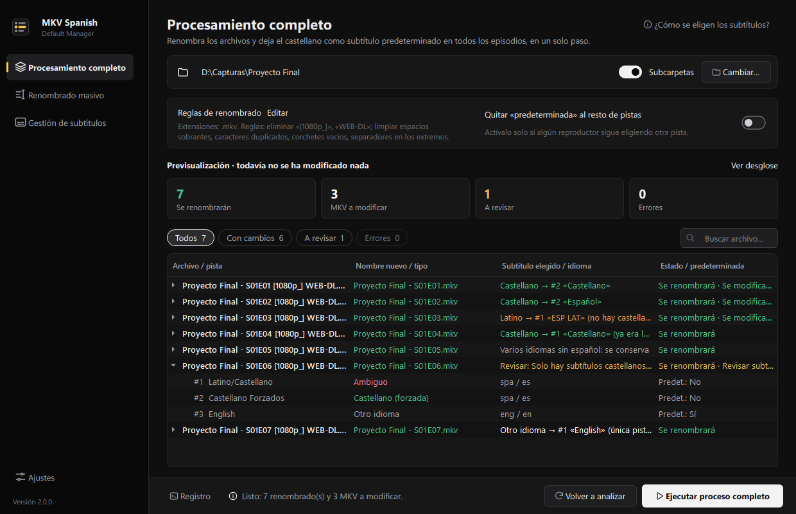

# MKV Spanish Default Manager



Aplicación de escritorio para Windows que deja el **castellano como subtítulo predeterminado** en tus archivos MKV
(nunca el latino si existe una alternativa castellana) y que, además, renombra los episodios por lotes.

La decisión se basa **solo en el nombre y los metadatos de cada pista**, no en el contenido de los subtítulos.
Solo se cambia el indicador de pista predeterminada con `mkvpropedit`: **el vídeo y el audio nunca se recodifican**
y el MKV no se reconstruye.

## Secciones

La ventana tiene una barra lateral con tres secciones de trabajo y los ajustes. Se abre en el procesamiento
completo, y la carpeta elegida se conserva al cambiar de sección.

| Sección | Qué hace |
|---|---|
| **Procesamiento completo** | Renombra los archivos y después fija el subtítulo predeterminado de todos los MKV, en un solo paso. |
| **Renombrado masivo** | Limpia y cambia los nombres de muchos archivos a la vez, con previsualización en vivo, historial y deshacer. |
| **Gestión de subtítulos** | Fija el castellano como subtítulo predeterminado sin tocar los nombres. |
| **Ajustes** | Ubicación de MKVToolNix, datos que guarda la aplicación (historial, diario, registro) y versión. |

Todas las secciones siguen el mismo flujo:

1. **Elige la carpeta** con «Elegir carpeta…», soltándola sobre el selector o escribiendo la ruta y pulsando Intro.
   El interruptor **Subcarpetas** incluye también los archivos de las subcarpetas.
2. **Revisa la previsualización.** El análisis es automático y de solo lectura: no se modifica nada hasta que lo confirmes.
   Las cifras clave aparecen arriba («Ver desglose» muestra el resumen completo) y la lista se puede filtrar por
   *Con cambios*, *A revisar* y *Errores* o buscar por nombre.
3. **Confirma** con el botón principal de la barra inferior. El progreso que se muestra es el real (archivo a archivo)
   y la ventana sigue respondiendo; las operaciones largas se pueden cancelar.
4. **Consulta el resultado** en el aviso superior y en la lista. El **registro técnico** detallado está en el botón
   «Registro» de la barra inferior.

## Instalación

**Con el EXE** no hay que instalar nada: `MKVSpanishDefaultManager.exe` ya incluye Python, la interfaz y
MKVToolNix (`mkvmerge` y `mkvpropedit`). Si el equipo tiene MKVToolNix instalado, se usa esa versión en su lugar.

**Desde el código fuente**:

1. Instala [Python 3.10 o posterior](https://www.python.org/downloads/) (marca *Add python.exe to PATH*).
2. Instala MKVToolNix: `winget install MoritzBunkus.MKVToolNix` o desde https://mkvtoolnix.download.
3. Ejecuta `install.bat` (crea `.venv` e instala PySide6) y después `run.bat`.

Si MKVToolNix está en otra ruta, indícala en **Ajustes → Ubicación de MKVToolNix** (la carpeta elegida tiene
prioridad sobre cualquier otra). Si falta, las secciones que lo necesitan lo avisan con un acceso directo a Ajustes;
el renombrado masivo funciona sin él.

## Procesamiento completo

Usa las reglas y extensiones configuradas en «Renombrado masivo» (se resumen en la propia sección, con un enlace
para editarlas). Al elegir la carpeta se prepara la previsualización: nombre nuevo de cada archivo y pista que se
elegirá en cada MKV. Al pulsar **Ejecutar proceso completo**:

1. Se comprueba que los archivos siguen como en la previsualización (si han cambiado, se vuelve a analizar).
2. Se renombra según las reglas.
3. Se analizan de nuevo los subtítulos de cada MKV **ya con su nombre definitivo** y se fija la pista predeterminada.

Prioridad de subtítulos en este modo:

1. Castellano explícito; después ESP / Español / Spanish genérico (misma lógica que la gestión de subtítulos).
2. **Latino solo si no existe castellano ni genérico válido** (nunca si existe).
3. Otro idioma solo si es la **única pista candidata**.
4. Sin español y con varias pistas de otros idiomas: se conserva la configuración original. Sin subtítulos: no se toca nada.

Los **forzados y comentarios** no cuentan como candidatos (solo se eligen si son la única pista del archivo).
Con pistas ambiguas, empates sin resolver o solo castellano/latino forzado junto a otras pistas, el archivo queda
**a revisar** y no se modifica. Un archivo con conflicto de nombre no se renombra, pero sus subtítulos sí se procesan.

Informe final: renombrados, sin cambio de nombre, MKV modificados, castellano / latino / otro idioma (única pista)
seleccionados, sin subtítulos, a revisar y errores, con el detalle por archivo. Deshacer desde «Renombrado masivo»
devuelve los nombres; el cambio de pista predeterminada no se revierte (queda anotado en `journal.jsonl`).

## Gestión de subtítulos

Al elegir la carpeta se analiza automáticamente y la lista muestra, por episodio, todas sus pistas con el tipo,
el idioma y el indicador de predeterminada antes y después (fondo verde: la pista que quedará como predeterminada).
**Procesar** modifica todos los episodios compatibles con una sola confirmación.

- **Modo simulación**: el botón pasa a «Simular cambios», no modifica nada y, al terminar, ofrece aplicar lo simulado.
- **Quitar «predeterminada» al resto de pistas**: opcional, para reproductores que siguen eligiendo otra pista.
- **Clic derecho sobre un episodio**: aplicar solo a ese archivo.

Los episodios sin español, con solo latino, a revisar o con error **no se modifican** en esta sección.

### Reglas de identificación

| Tipo | Ejemplos de nombre |
|---|---|
| Latino | ESP LAT, ESP-LAT, ESP_LAT, Español Latino, Spanish Latino, Latino, Latin American Spanish, Spanish (Latin America), LATAM, Español (México), IETF es-419 / es-MX… |
| Castellano | Castellano, ESP CAST, ESP-CAST, Spanish (Spain), European Spanish, es-ES, Español (España) |
| Genérico (cuenta como castellano) | ESP, Español, Spanish, o idioma `spa` sin nombre ni región |

Prioridad de evidencias: **nombre de pista > etiqueta IETF > código de idioma**.
Un nombre genérico con IETF latino (`ESP` + `es-419`) se considera latino.
«Latin» suelto no cuenta como latino (podría ser el idioma latín).

### Prioridad de selección

1. Castellano explícito. 2. Español genérico. 3. Si solo hay latino, en esta sección no se modifica nada y se mantiene como esté.

### Casos especiales

- Los **comentarios** nunca se eligen. Las pistas **forzadas** nunca se eligen si hay una completa.
- Entre pistas equivalentes se prefiere la normal sobre la SDH; si sigue habiendo empate, se conserva la que ya es predeterminada.
- **Se marca para revisión y no se toca el archivo** cuando hay un empate sin resolver, una pista de nombre ambiguo
  (p. ej. «Latino/Castellano») que podría ser mejor candidata, o solo existe castellano forzado.
- Además de activar la castellana y desactivar las latinas, se desactiva la predeterminada de **otras pistas españolas completas**
  que compitan (solo puede haber una). Las pistas de otros idiomas, forzadas y de comentarios no se tocan,
  salvo con la opción «Quitar «predeterminada» al resto de pistas».
- Antes de modificar se vuelve a leer el archivo y, tras `mkvpropedit`, se verifica que los indicadores quedaron como se esperaba.
- Cada cambio real se anota en `%APPDATA%\MKVSpanishDefaultManager\journal.jsonl` con los valores anteriores.

## Renombrado masivo

Las reglas están a la izquierda y la previsualización (nombre original → nuevo + estado) a la derecha; se
actualiza mientras escribes.

- **Archivos incluidos**: MKV, MP4, AVI, SRT, ASS, otras extensiones (`ssa, sub…`) o «Todos los archivos».
  Los archivos ocultos y de sistema nunca se incluyen.
- **Eliminar texto**: uno o varios textos o patrones, uno por línea. Ej.: `[1080p_]` convierte
  `Titulo chulo [1080p_] 2026.mkv` en `Titulo chulo 2026.mkv`.
- **Sustituir texto**: tabla «buscar → reemplazar por».
- **Limpieza automática**: espacios sobrantes, caracteres duplicados (`.. -- __`), corchetes y paréntesis vacíos y
  separadores sueltos en los extremos.
- **Prefijo y sufijo** (el sufijo va antes de la extensión).
- **Opciones avanzadas**: expresiones regulares (aplican a eliminar y sustituir; grupos con `\1`; una regex inválida
  se avisa y bloquea el renombrado) y distinción de mayúsculas.

Orden de aplicación: eliminar → sustituir → limpieza → prefijo/sufijo. **La extensión nunca se modifica.**

**Seguridad**: nombres duplicados, nombres que ya existen y nombres vacíos o no válidos en Windows quedan como
*Bloqueados* y **no se tocan**; nunca se sobrescribe nada (se comprueba otra vez justo antes de cada renombrado).
Si la carpeta cambia tras la previsualización, se pide revisarla de nuevo. Los renombrados encadenados o cruzados
pasan por nombres temporales (`.mkvsd_tmp_…`; si ves alguno tras un corte, su contenido está intacto).

**Historial y deshacer**: cada renombrado se guarda en `%APPDATA%\MKVSpanishDefaultManager\rename_history.jsonl`.
«Deshacer último renombrado» devuelve los nombres anteriores (sin pisar nada; si algo no se puede, queda pendiente)
y «Historial» muestra todas las operaciones. Desde el historial o desde Ajustes puedes:

- **Desactivar «Guardar historial»**: los próximos renombrados (también los del procesamiento completo) no se
  anotan y, por tanto, **no se podrán deshacer**; la confirmación lo avisa. Lo ya guardado se conserva.
- **Borrar historial**: elimina todas las operaciones guardadas (con confirmación). Los archivos no se tocan, pero
  ya no se podrá deshacer ninguno de esos renombrados.

## Acceso directo con icono

Ejecuta `create_shortcut.bat`: crea el acceso «MKV Spanish Default Manager» con su icono en el escritorio y en el
menú Inicio. Para anclarlo, búscalo en Inicio y elige «Anclar a Inicio» o «Anclar a la barra de tareas»
(requiere haber ejecutado antes `install.bat`).

## Icono

El icono es original: una lista de pistas de subtítulos con la predeterminada elegida en amarillo. Los diseños
vectoriales están en `assets/icon.svg` (40 px o más) y `assets/icon-small.svg` (versión simplificada para 16–32 px).
`tools/make_icon.py` genera a partir de ellos `assets/icon.ico` (16 a 256 px) y `assets/icon.png` (512 px) usando
solo PySide6.

## Pruebas

`python -m unittest discover -s tests -t .` (no necesitan PySide6 ni MKVToolNix).

## Generar el EXE

`build_exe.bat` crea `dist\MKVSpanishDefaultManager.exe` con PyInstaller, con el icono integrado y MKVToolNix
incluido. Para compilarlo hace falta tener MKVToolNix instalado: `tools/bundle_mkvtoolnix.py` copia de esa
instalación `mkvmerge.exe`, `mkvpropedit.exe`, su licencia y las de sus bibliotecas a `vendor/MKVToolNix/`
(con un `LEEME.txt` que indica la versión y dónde está su código fuente), y de ahí pasan al EXE. Si está en otra
ruta: `build_exe.bat "C:\ruta\MKVToolNix"`.

Orden en el que la aplicación busca MKVToolNix: carpeta elegida en Ajustes → PATH → Archivos de programa /
AppData → carpeta `MKVToolNix` junto a la aplicación → copia incluida en el EXE.

## Estructura

```
main.py                  punto de entrada (icono, escalado y tema)
mkvsd/classifier.py      clasificación de pistas por nombre y metadatos
mkvsd/selector.py        decisión de pista predeterminada (gestión de subtítulos)
mkvsd/selector_full.py   reglas de subtítulos del procesamiento completo
mkvsd/mkvtools.py        mkvmerge -J / mkvpropedit
mkvsd/scanner.py         búsqueda y análisis de MKV
mkvsd/applier.py         aplicar, simular y verificar
mkvsd/batch.py           procesamiento por lotes
mkvsd/renamer.py         reglas, plan y ejecución segura del renombrado
mkvsd/rename_history.py  historial y deshacer
mkvsd/fullmode.py        previsualización, ejecución e informe del modo completo
mkvsd/workers.py         hilos Qt (las operaciones largas no bloquean la ventana)
mkvsd/ui/                interfaz: ventana, secciones, componentes, tema e iconos
assets/                  icono (SVG, ICO y PNG)
tools/make_icon.py       regenera el icono
tools/bundle_mkvtoolnix.py  prepara MKVToolNix para incluirlo en el EXE
tests/                   pruebas unitarias
```

## Créditos

Hecho por **Dreex**.

MKV Spanish Default Manager no edita los MKV por sí mismo: se apoya en las herramientas de MKVToolNix para leer
las pistas y cambiar sus indicadores. Lo que añade es la clasificación de las pistas, las reglas de selección del
castellano, el procesamiento por carpetas, el renombrado masivo con deshacer y la interfaz.

| Componente | Uso | Licencia |
|---|---|---|
| [MKVToolNix](https://mkvtoolnix.download) (`mkvmerge`, `mkvpropedit`), de Moritz Bunkus y colaboradores | Leer las pistas y cambiar el indicador de predeterminada. El EXE incluye ambos programas sin modificar, con su licencia; [código fuente](https://mkvtoolnix.download/source.html). | [GPL-2.0](https://gitlab.com/mbunkus/mkvtoolnix/-/blob/main/COPYING) |
| [Qt for Python (PySide6)](https://doc.qt.io/qtforpython-6/) | Interfaz gráfica. | [LGPL-3.0](https://doc.qt.io/qtforpython-6/licenses.html) |
| [PyInstaller](https://pyinstaller.org) | Solo para generar el EXE. | [GPL-2.0 con excepción para el ejecutable generado](https://pyinstaller.org/en/stable/license.html) |

## Licencia

El código de este proyecto se distribuye bajo la [licencia MIT](LICENSE). Copyright (c) 2026 Dreex.
Las dependencias anteriores mantienen sus propias licencias.

**Exención de responsabilidad**: el programa modifica los nombres y los metadatos de los archivos que elijas.
Se ofrece «tal cual», sin garantía de ningún tipo; el autor no se hace responsable del uso que se haga del
programa ni de los archivos o contenidos que se procesen con él. Revisa siempre la previsualización y conserva
copias de seguridad de lo que te importe.
